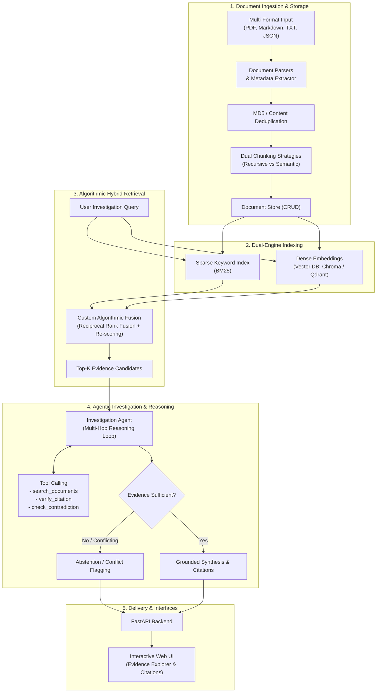

# 🔍 Applied AI – AI Investigation Engine

> Intelligent Multi-Hop Investigation & Reasoning System for Complex Document Analysis

[](https://www.python.org/)
[](LICENSE)
[](#architecture)

---

## 📌 Overview

**AI Investigation Engine** is an advanced artificial intelligence system built to investigate, correlate, and analyze large-scale, multi-source document collections.

Unlike standard conversational "Chat with PDF" wrappers that retrieve single top-ranked chunks, this engine operates as an **investigative multi-step reasoning agent**:
- Correlates facts across disjoint documents (Multi-Hop QA).
- Detects contradictions and conflicting reports.
- Enforces strict groundedness and transparent source attribution (citations with snippet & line references).
- Refuses to hallucinate when evidence is absent or insufficient.

---

## 🏛️ System Architecture



---

## 🚀 Key Features

| Capability | Implementation |
|---|---|
| **Multi-Format Ingestion** | Native extraction for PDF (`pypdf`), Markdown, Plain Text & JSON with metadata extraction. |
| **Dual Chunking** | Comparison of *Recursive Character Chunking* vs *Semantic/Section-based Chunking*. |
| **Hybrid Search** | Combines Dense Semantic Retrieval with Sparse BM25 via custom **Reciprocal Rank Fusion (RRF)**. |
| **Investigation Agent** | Structured Tool Calling (`search_documents`, `verify_citation`, `detect_contradiction`). |
| **Safety & Truthfulness** | Built-in contradiction detection and reliable abstention against ungrounded hallucinations. |
| **Automated Evaluation** | Quantitative benchmark suite testing 40 diverse scenarios across Recall@K, MRR, Correctness, and Citation Accuracy. |

---

## ⚙️ Installation & Quickstart

### 1. Prerequisites
- Python 3.11+
- Git

### 2. Clone Repository
```bash
git clone https://github.com/your-username/ai-investigation-engine.git
cd ai-investigation-engine
```

### 3. Virtual Environment
```bash
python -m venv .venv
# Windows
.\.venv\Scripts\activate
# Linux/macOS
source .venv/bin/activate
```

### 4. Install Dependencies
```bash
pip install -r requirements.txt
```

### 5. Environment Variables
Copy `.env.example` to `.env` and fill in your API keys:
```bash
cp .env.example .env
```

---

## 💻 Running the Services

### Start FastAPI Backend
```bash
uvicorn src.api.app:app --host 0.0.0.0 --port 8000 --reload
```
Interactive API docs available at: `http://localhost:8000/docs`

### Start Web UI (Streamlit)
```bash
streamlit run src/ui/app.py
```
Access the application at: `http://localhost:8501`

---

## 🧪 Evaluation Suite

To run the automated 40-case evaluation benchmark:
```bash
pytest tests/ -v
python -m src.evaluation.evaluator --config configs/eval_config.yaml
```
Results and comparative metrics are saved to `docs/EVALUATION_REPORT.md`.
